# api-test-e10 Execution Flowchart

This document is rendered using [Mermaid](https://mermaid.js.org/). Supported by VSCode, GitHub, Obsidian, Typora, and other Markdown viewers.

> For new task preflight gates, see `doc/preflight_gates_new.md`; for maintenance task preflight gates, see `doc/preflight_gates_maintenance.md`. The 5 new task creation modes are detailed in `doc/mode_capture_driven.md`, `doc/mode_reference_case.md`, `doc/mode_curl_manual.md`, `doc/mode_java_controller_source.md`, and `doc/mode_api_tpl.md`. The 4 maintenance modes are detailed in `doc/mode_maintenance_*.md`, with shared maintenance context in `doc/maintenance_prompt_context.md`. This file maintains flowcharts and decision logic.

---

## 1. Overview (Entry Flow)

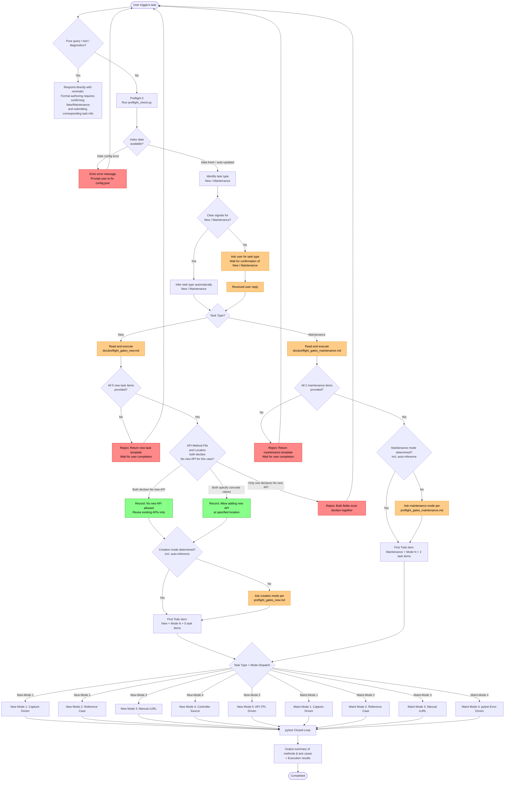

---

## 2. Preflight 0 / New Preflight / Maintenance Preflight Decision Gates

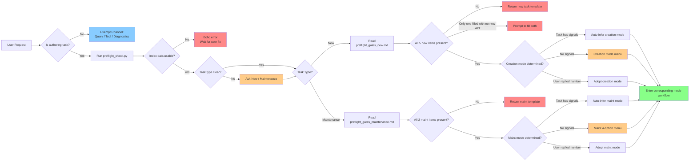

---

## 3. Overview of New Tasks (Entry to Mode Dispatch)

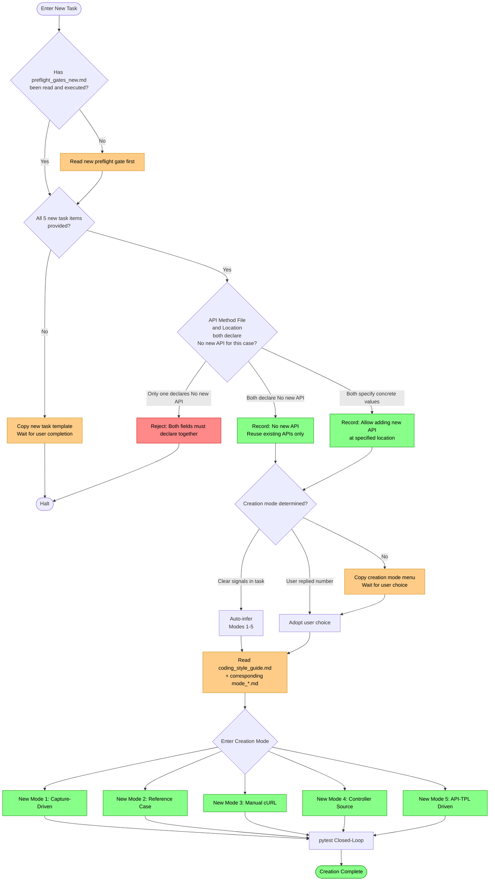

### Key Principles for New Tasks

- Read `doc/preflight_gates_new.md` first and complete 5-item validation.
- `[fixture]` is optional; all other fields must contain real files, real locations, and complete descriptive case names.
- `[API Method File]` and `[API Method Location]` can both declare "No new API for this test case"; declaring only one must be rejected.
- When "No new API" is declared, only existing methods may be reused.
- Prompt with menu if mode is unconfirmed; auto-infer when signals are unambiguous.
- Read `doc/coding_style_guide.md` and the selected `doc/mode_*.md` before writing code.

---

## 4. New Creation Mode ①: Capture-Driven

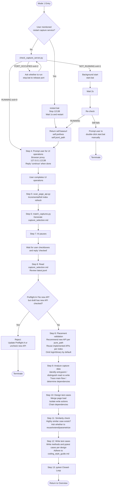

### Mode ① Key Steps & Artifacts

| Step | Action | Artifact / Output |
|---|---|---|
| 1 | Check restart necessity | Check if user explicitly asked for capture restart |
| 2 | Handle capture service | Restart: `restart.bat`; Otherwise: inspect port and run `start.bat` as needed |
| 3 | Return service info | `self.baseurl` / `self.prefixes` / `self.jsonl_path` |
| 4 | Prompt for UI operations | Browser proxy and certificate guidance; reply "continue" when done |
| 5 | Refresh index | `tools/page_api_index.sqlite3` |
| 6 | Generate draft | `api_test_dwp_temp/capture_selection.md` |
| 7 | Wait for user selection | `[x]/[ ]` checkboxes; AI must halt |
| 8 | Read selection & validate placement | Process checked APIs only; validate new APIs vs preflight, reuse per index |
| 9 | Analyze capture data | Entry requests, read/write types, main flow, API dependencies |
| 10 | Design test cases | Merge page loads, separate write actions, chain dependencies |
| 11 | Similarity check | Suggestions for highly similar cases (reuse/extend/parametrize) |
| 12 | Write test cases | New methods to `[API Method File]`, cases to `[Test Case File]` |
| 13 | pytest closed-loop | Execution logs + pass/fail statistics |

---

## 5. New Creation Mode ②: Reference Existing Case

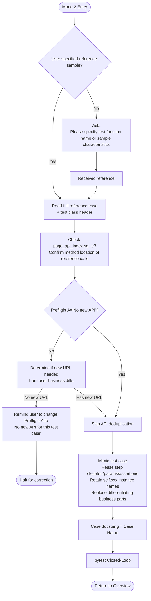

### Mode ② Key Principles (Forbidden Actions)

| Action | Allowed |
|---|---|
| Add capabilities not present in reference (e.g. grouping, sorting) | ❌ Forbidden |
| Complicate a simplified reference case | ❌ Forbidden |
| Add `@pytest.mark.skip` to new case | ❌ Unless requested as placeholder |
| Introduce API instances not in reference | ❌ Forbidden |
| Modify the reference case itself | ❌ Forbidden (unless requested) |

---

## 6. New Creation Mode ③: Manual cURL

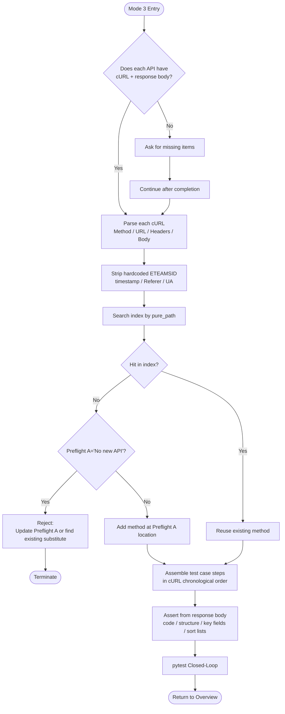

### Mode ③ cURL Processing Checklist

| cURL Element | Handling |
|---|---|
| `-X GET/POST/PUT/DELETE` | Pass as method argument of API method |
| `--url "https://host/api/xxx?a=1"` | Split pure_path + query parameters |
| `-H "Cookie: ETEAMSID=xxxx"` | Remove hardcoded cookie, acquire dynamically via login fixture |
| `-H "Content-Type: application/json"` | Retain |
| `-H "Referer: ..."` / `-H "User-Agent: ..."` | Remove, do not write to method |
| `-d '{"a":1,"timestamp":...}'` | Replace `timestamp/_t` with dynamic generation at call time |
| `--data-urlencode` | Encode into payload form |

---

## 7. New Creation Mode ④: Java Controller Source Reference

```mermaid
flowchart TD
    F4Start([Mode 4 Entry]) --> Source{Controller source code<br/>or Jacoco URL provided?}
    Source -- No --> AskSource[Ask for source file / Markdown / Jacoco URL]
    AskSource --> SourceRecv[Received source info]
    Source -- Yes --> Analyze
    SourceRecv --> Analyze

    Analyze[Run analyze_java_controller.py<br/>Extract mapping & deduplicate by api_url+method]
    Analyze --> Draft[Generate java_sourceCode_analysisResult.md<br/>Uncovered APIs checked x by default<br/>Scenario groupings editable]
    Draft --> StopDraft[AI pauses<br/>Wait for user adjustment of checkboxes and groups]
    StopDraft --> Confirm[User confirms to proceed with draft]

    Confirm --> ReadDraft[Re-read adjusted draft<br/>Process retained checked endpoints and scenarios only]
    ReadDraft --> Design[Design test cases per call chain and business flow<br/>Document inference rationale]
    Design --> Ref[Find similar existing cases<br/>or read user-specified reference]
    Ref --> Landing{Is test case file _CSC.py?}
    Landing -- Yes --> UseCSC[Write directly to dedicated file]
    Landing -- No --> RemindCSC[Remind once to suggest _CSC.py<br/>Proceed with user choice if insisted]
    RemindCSC --> UseUserFile[Proceed with user-specified file]

    UseCSC --> Compose[Add/reuse API methods<br/>Write basic assertions + print full response]
    UseUserFile --> Compose
    Compose --> Run1[First pytest run<br/>Obtain actual response]
    Run1 --> Assert[Complete assertions based on actual response]
    Assert --> Retry{Debug iterations < 3?}
    Retry -- Yes --> Verify[pytest Closed-Loop]
    Verify --> Result{Passed?}
    Result -- Yes --> F4End([Return to Overview])
    Result -- No --> Retry
    Retry -- No --> Stop3[Halt further attempts<br/>Summarize failure causes (payload / variables / auth / env)]
    Stop3 --> F4End
```

### Mode ④ Key Steps & Artifacts

| Step | Action | Artifact / Output |
|---|---|---|
| 1 | Read Controller/Jacoco | Java source, line numbers, Jacoco coverage colors |
| 2 | Extract APIs & deduplicate | Combine class + method mappings, query `page_api_index.sqlite3` |
| 3 | Generate editable draft | `api_test_dwp_temp/java_sourceCode_analysisResult.md` |
| 4 | User adjusts draft | Check APIs, reorganize scenarios, add reference notes |
| 5 | Design test cases | Split by call chains; do not dump all `[x]` APIs into one monolithic case |
| 6 | Reference existing cases | AI searches or user specifies reference cases for fixtures/assertions |
| 7 | Author `_CSC.py` test cases | Remind once if not `_CSC.py`; user choice honored |
| 8 | Two-stage assertions | Basic assertions + print response first, then complete real assertions |
| 9 | pytest closed-loop | Up to 3 debug iterations; summarize causes and halt if unresolved |

---

## 8. New Creation Mode ⑤: API-TPL Driven

```mermaid
flowchart TD
    F5Start([Mode 5 Entry]) --> ReadMode[Read doc/mode_api_tpl.md<br/>+ coding_style_guide.md<br/>+ preflight_gates_new.md]
    ReadMode --> Landing{Does api-landing.md exist?}
    Landing -- No --> Export[export-report-artifacts<br/>Export landing package from ai-result]
    Export --> Landing2{Exists after export?}
    Landing2 -- No --> AskLanding[Reject: Provide run directory<br/>or complete analysis report first]
    AskLanding --> F5End0([Terminate])
    Landing2 -- Yes --> ReadLanding
    Landing -- Yes --> ReadLanding

    ReadLanding[Read api-landing.md only<br/>Forbidden to load entire ai-result.md<br/>Forbidden to use functional-cases.html]
    ReadLanding --> Checked{Are there manually checked<br/>x API-TPL entries?}
    Checked -- No --> RejectNone[Reject: Unchecked items must not be created<br/>Remain pending approval]
    RejectNone --> F5End1([Terminate])
    Checked -- Yes --> Scope[Step 0: Process x entries only<br/>Record id/method/path/params<br/>trigger_steps/related_tc]

    Scope --> MaintSkip{Is Mode 4 maintenance section<br/>completely unchecked?}
    MaintSkip -- Yes --> SkipMaint[Skip maintenance<br/>Zero changes to existing cases]
    MaintSkip -- No --> NoteMaint[Maintenance items follow Mode 4 separately<br/>Do not handle in Mode 5]
    SkipMaint --> Loop
    NoteMaint --> Loop

    Loop[Process each API-TPL-x] --> L1[Step 1: L1 Deduplication<br/>page_api_index.sqlite3<br/>api_url + method]
    L1 --> ParamMatch{Path contains param placeholder?}
    ParamMatch -- Yes --> Fuzzy[Multi-segment fuzzy match<br/>Literal segments must match]
    ParamMatch -- No --> Exact[Structural path match]
    Fuzzy --> Hit{Index hit?}
    Exact --> Hit

    Hit -- Yes --> Reuse[Reuse existing method<br/>Write real path for URL<br/>Do not recreate]
    Hit -- No --> Place[Step 2: Determine placement<br/>placement_hints / module directory]
    Place --> NewMethod[Step 3: Add page_api method<br/>coding_style_guide structure]
    NewMethod --> Trigger{docstring contains<br/>Trigger Steps?}
    Trigger -- No --> FixTrigger[Add Trigger Steps<br/>Source: TPL.trigger_steps / related_tc]
    FixTrigger --> Trigger
    Trigger -- Yes --> CaseWrite
    Reuse --> NeedTrigger{Reused method lacks<br/>Trigger Steps?}
    NeedTrigger -- Yes --> FixTrigger2[Add Trigger Steps]
    FixTrigger2 --> CaseWrite
    NeedTrigger -- No --> CaseWrite

    CaseWrite[Step 4: Author pytest test case<br/>Use established fixture add_form_data<br/>Title must have semantic note]
    CaseWrite --> TitleOk{Case docstring has<br/>semantic note?}
    TitleOk -- No --> FixTitle[Add verification description]
    FixTitle --> TitleOk
    TitleOk -- Yes --> Discipline{Fake green / skip / invented params?}
    Discipline -- Yes --> RejectBad[Reject for correction]
    RejectBad --> CaseWrite
    Discipline -- No --> Pytest[Step 5: pytest Closed-Loop<br/>test_case + PYTHONPATH=.]

    Pytest --> Pass{Passed?}
    Pass -- No --> FixReal[Fix method/assertions from real response<br/>Green before removing debug prints]
    FixReal --> Pytest
    Pass -- Yes --> Clean[Delete debug prints<br/>Recommend re-run to confirm]
    Clean --> More{More unprocessed<br/>API-TPL-x?}
    More -- Yes --> Loop
    More -- No --> ScanIdx[Step 6: Refresh page_api_index]
    ScanIdx --> Deliver[Step 7: Output summary of methods/cases<br/>pytest results / Forbidden to commit push]
    Deliver --> F5End([Return to Overview])

    classDef f5wait fill:#fc8,stroke:#c80,color:#000
    classDef f5pass fill:#8f8,stroke:#080,color:#000
    classDef f5reject fill:#f88,stroke:#c00,color:#000
    class AskLanding,RejectNone,RejectBad,FixTrigger,FixTrigger2,FixTitle,FixReal f5wait
    class F5End,Deliver,Reuse,NewMethod f5pass
    class F5End0,F5End1 f5reject
```

### Mode ⑤ Key Steps & Artifacts

| Step | Action | Artifact / Output |
|---|---|---|
| 0 | Confirm checked scope | Only process `[x]` `API-TPL-*` in `api-landing.md`; record method/path/params/`trigger_steps`/`related_tc` |
| 1 | L1 deduplication | `tools/page_api_index.sqlite3`; `{param}` **multi-segment fuzzy match** |
| 2 | Placement | `placement_hints` / module page_api; write real path when `{param}` matches |
| 3 | Author/reuse page_api | Standard structure per `coding_style_guide.md`; docstring must include **`Trigger Steps:`** |
| 4 | Author pytest cases | Established fixtures (e.g. `add_form_data`); case title **`--` semantic note**; no skip/fake green |
| 5 | pytest closed-loop | `test_case` + `PYTHONPATH=.`; fix based on real responses; clean debug prints after green |
| 6 | Refresh index | Update `page_api_index.sqlite3` |
| 7 | Stop and deliver | Methods/cases list + pytest results; **Forbidden to run git commit / push** |

### Mode ⑤ Key Principles (Forbidden Actions)

| Action | Allowed |
|---|---|
| Process unchecked `[ ]` API-TPLs | ❌ Forbidden |
| Load entire `ai-result.md` for Mode 5 | ❌ Forbidden (use `api-landing.md` only) |
| Use `functional-cases.html` to write automation | ❌ Forbidden |
| Fabricate URLs, parameter names, or irrelevant trigger steps | ❌ Forbidden |
| Method missing `Trigger Steps:` or case title lacking semantic note | ❌ Incomplete Deliverable |
| Write Mode 5 flow into Mode 4 / modify Mode 4 docs | ❌ Forbidden |
| Retain debug `print` statements after passing | ❌ Forbidden |
| Execute `git commit` / `git push` | ❌ Forbidden |

---

## 9. Overview of Maintenance Tasks (Entry to Mode Dispatch)

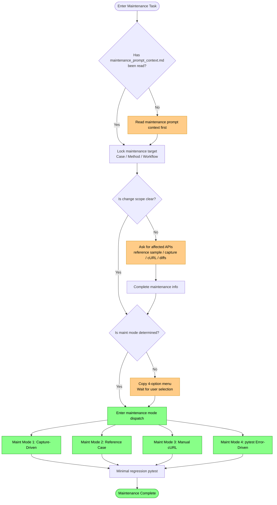

### Key Principles for Maintenance Tasks

- Search existing implementations first; do not assume new creation.
- Distinguish "case only" vs "method + case updates".
- Prioritize capture backtracking for broad changes, and reference samples or cURL for targeted changes.
- For pytest error-driven maintenance, default to `/test-fixing` first, using `/Debugging` only when stack or API context is unclear.
- Adding methods during maintenance is a fix mechanism, not the task objective.
- Run minimal regression on affected test cases; do not execute full test suite by default.

---

## 10. Maintenance Mode ①: Capture-Driven

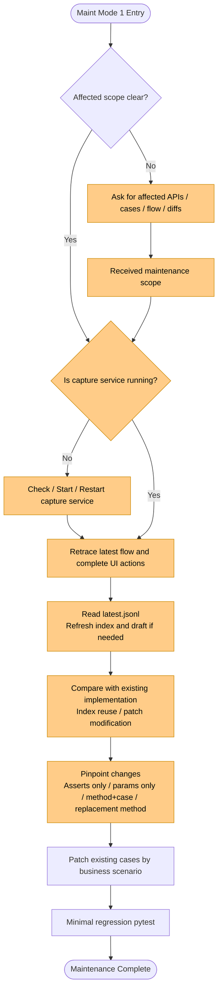

### Maintenance Mode ① Key Steps & Artifacts

| Step | Action | Artifact / Output |
|---|---|---|
| 1 | Lock scope | Affected APIs, cases, workflows, diffs |
| 2 | Check capture service | Start / restart / verify active service |
| 3 | Acquire latest flow | `latest.jsonl`, index and draft if needed |
| 4 | Compare with implementation | Reusable methods, patchable methods, affected cases |
| 5 | Pinpoint changes | Assertions / parameters / fixtures / calls / replacement methods |
| 6 | Patch by business scenario | Minimal localized repairs to existing cases |
| 7 | Minimal regression | Execute pytest on affected test cases |

---

## 11. Maintenance Mode ②: Reference Existing Case

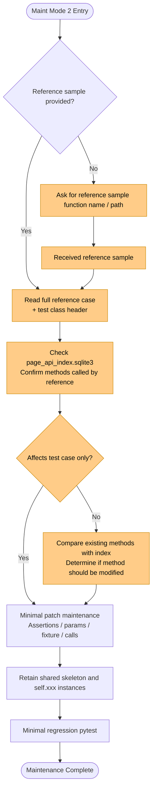

### Maintenance Mode ② Key Principles (Forbidden Actions)

| Action | Allowed |
|---|---|
| Add capabilities not in reference (e.g. grouping, sorting) | ❌ Forbidden |
| Turn local fixes into complex refactors | ❌ Forbidden |
| Attach `@pytest.mark.skip` to maintained cases | ❌ Unless requested as placeholder |
| Introduce API instances not in reference | ❌ Forbidden |
| Modify the reference case itself | ❌ Forbidden (unless requested) |

---

## 12. Maintenance Mode ③: Manual cURL

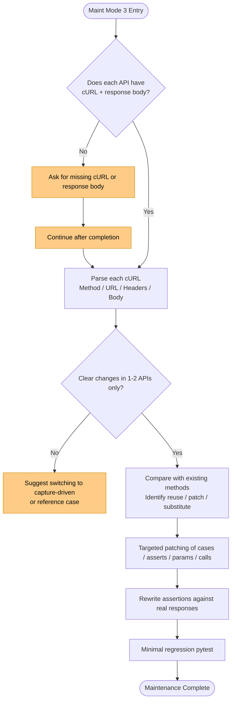

### Maintenance Mode ③ cURL Processing Checklist

| cURL Element | Handling |
|---|---|
| `-X GET/POST/PUT/DELETE` | Pass as method argument of API method |
| `--url "https://host/api/xxx?a=1"` | Split pure_path + query parameters |
| `-H "Cookie: ETEAMSID=xxxx"` | Remove hardcoded cookie, acquire dynamically via login fixture |
| `-H "Content-Type: application/json"` | Retain |
| `-H "Referer: ..."` / `-H "User-Agent: ..."` | Remove, do not write to method |
| `-d '{"a":1,"timestamp":...}'` | Replace `timestamp/_t` with dynamic generation at call time |
| `--data-urlencode` | Encode into payload form |

---

## 13. Maintenance Mode ④: pytest Error-Driven

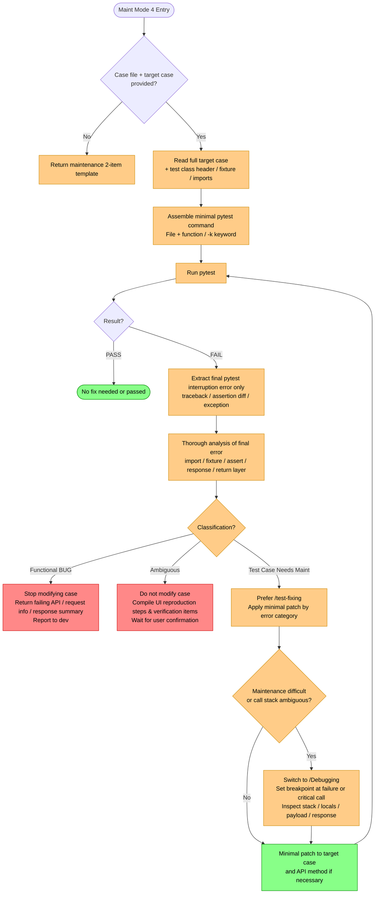

### Maintenance Mode ④ Execution Checklist

| Step | Action | Artifact / Output |
|---|---|---|
| 1 | Lock target | `[Test Case File]` + `[Test Case Location]` |
| 2 | Read context | Target case, class header, fixture, imports, instances |
| 3 | Run pytest | Minimal scope command, execution directory, PYTHONPATH |
| 4 | Extract final error | Final pytest traceback, assertion diff, or exception |
| 5 | Categorize | Functional BUG: stop and report; Ambiguous: return reproduction steps; Maintenance: proceed to fix |
| 6 | Prefer `/test-fixing` | Apply minimal patch following test repair process |
| 7 | Fallback `/Debugging` | Breakpoint inspection when context/stack is unclear |
| 8 | Loop verification | Re-run same minimal pytest until passing or reclassified |

---

## 14. pytest Closed-Loop (Shared across All Modes)

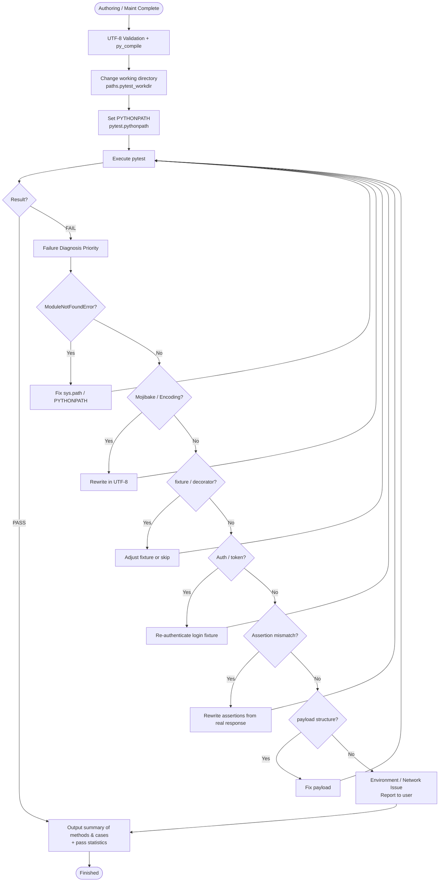

---

## 15. Mode Comparison Matrix

| Dimension | Mode 1 Capture | Mode 2 Reference | Mode 3 cURL | Mode 4 Controller Source | Mode 5 API-TPL |
|---|---|---|---|---|---|
| Typical Scenario | Multiple new APIs / complex workflow | Batch authoring similar cases / params | Capture unavailable / excessive data | Backend defined APIs without test coverage | git-diff-analyse gaps / checked templates |
| Preparation Cost | Low (UI operation only) | Medium (specify reference) | High (collect cURL + response) | Medium (provide Controller/Jacoco) | Medium (run analysis + check api-landing) |
| New API Capability | ✅ Index-driven deduplication | ⚠️ No new API by default; create if needed | ✅ Create per cURL | ✅ Extract from source & deduplicate | ✅ Deduplicate per TPL & create/reuse |
| AI Judgment | Low (index + draft) | Medium (understand reference) | Medium (understand cURL semantics) | Medium-High (design call chains & scenarios) | Low (template-driven) |
| Most Common Failure | Auth / browser proxy | Incorrect reference sample | Incomplete cURL / missing response | Payload/variables not determined from source | Creating unchecked items / missing trigger steps |
| Closed-Loop Strictness | Strong (pause on draft) | Strong (read reference) | Strong (cURL+response paired) | Strong (pause on draft, up to 3 debug runs) | Strong (checked only, real green, no commit) |

### Maintenance Mode Matrix

| Dimension | Maint Mode 1 Capture | Maint Mode 2 Reference | Maint Mode 3 cURL | Maint Mode 4 pytest |
|---|---|---|---|---|
| Typical Scenario | Multi-API / multi-case workflow change | Localized patch to single/similar cases | Targeted fix for 1-2 APIs | Direct fix based on failed test errors |
| Preparation Cost | Medium (latest flow) | Low (reference sample) | Medium (cURL + response) | Low (target test case) |
| Flow Tracing | Strong (trace latest flow) | Medium (reference-dependent) | Weak (best for explicit diffs) | Medium (inferred from error) |
| Granularity | Workflow level | Test case level | Endpoint / local level | Failure point level |
| Most Common Failure | Incomplete capture scope | Incorrect reference sample | Incomplete response/diffs | Non-code issues (env/auth), or ambiguous stack |
| Closed-Loop Strictness | Strong (minimal regression) | Strong (target case regression) | Strong (affected case regression) | Strong (same target pytest loop) |

---

## 16. Mapping between Flowchart and SKILL.md

| Flowchart Section | SKILL.md Section |
|---|---|
| 1. Overview | 🚨 Preflight Gates (New / Maintenance Dispatch) |
| 2. Decision Gates | Preflight 0 + `preflight_gates_new.md` / `preflight_gates_maintenance.md` |
| 3. Overview of New Tasks | `doc/preflight_gates_new.md` + new mode documents |
| 4. New Mode ① | `doc/mode_capture_driven.md` |
| 5. New Mode ② | `doc/mode_reference_case.md` |
| 6. New Mode ③ | `doc/mode_curl_manual.md` |
| 7. New Mode ④ | `doc/mode_java_controller_source.md` |
| 8. New Mode ⑤ | `doc/mode_api_tpl.md` |
| 9. Overview of Maintenance Tasks | `doc/maintenance_prompt_context.md` + maintenance mode documents |
| 10. Maintenance Mode ① | `doc/mode_maintenance_capture_driven.md` |
| 11. Maintenance Mode ② | `doc/mode_maintenance_reference_case.md` |
| 12. Maintenance Mode ③ | `doc/mode_maintenance_curl_manual.md` |
| 13. Maintenance Mode ④ | `doc/mode_maintenance_pytest_driven.md` |
| 14. pytest Closed-Loop | Core Principles → 5. Tests Must Form a Closed Loop |
| 15. Comparison Matrix | Shared specifications across all modes |
| Appendix A. Hook Sequence | 🚨 Preflight 0 (hook auto-execution) + `.claude/settings.json` `hooks.PreToolUse` |

---

## 17. Maintenance Notes

- This document maintains **two-way consistency** with `SKILL.md`: update both sides synchronously when workflows change.
- Mermaid syntax prioritizes compatibility with GitHub and VSCode Mermaid extensions.
- To export diagrams as images, use [Mermaid Live Editor](https://mermaid.live/).

---

## Appendix A: PreToolUse Hook Sequence Diagram

Describes how Claude Code intercepts `Skill({skill: "api-test-e10"})`, spawns `preflight_hook.py`, and injects `preflight_check.py` output into the AI context.

> Implementation: `hooks/preflight_hook.py` + project `.claude/settings.json` `hooks.PreToolUse.matcher="Skill"`.

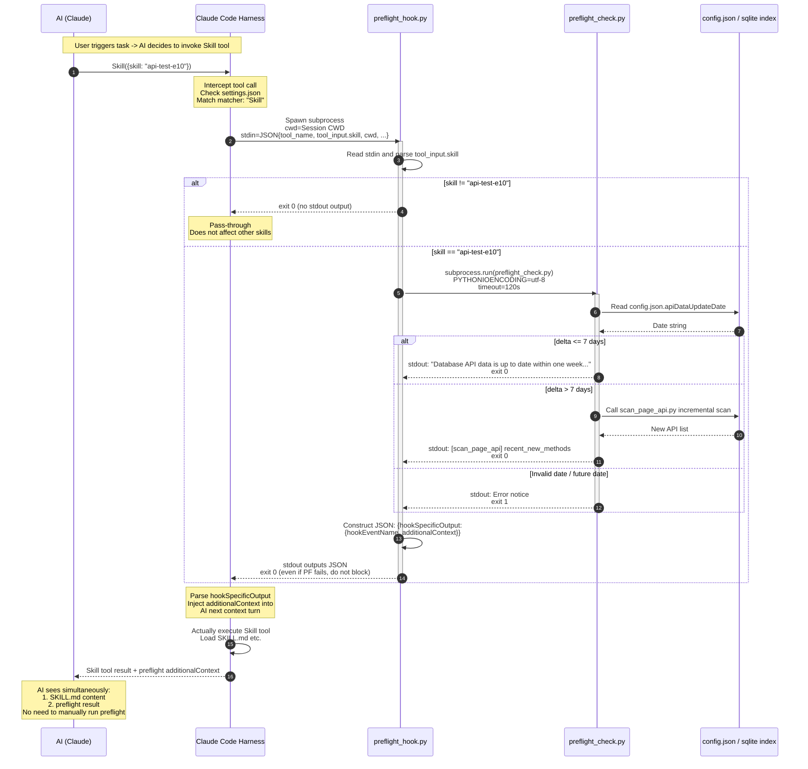

### Key Timing Constraints

| Step | Sync / Async | Failure Handling |
|---|---|---|
| ②→③ Harness calls hook | **Synchronous blocking** | Skill tool does not execute until hook exits |
| ④ Hook parses stdin | Synchronous | JSON parse fail → exit 0 immediately |
| ⑤ Skill name filter | Synchronous | Mismatch → exit 0 immediately without running PF |
| ⑥→⑩ Spawn preflight | Synchronous blocking | timeout=120s; on timeout → inject diagnostics, exit 0 |
| ⑪ JSON output | Synchronous | Always exit 0 (PF failure does not block Skill) |
| ⑫ Inject additionalContext | Handled by harness | Injected into AI context as system message |

### Key Design Trade-offs

- **Never Block**: Even if preflight itself crashes, hook exits 0; it is better for AI to see diagnostic info than for the entire skill to become unavailable.
- **Secondary Filtering in Script**: `matcher: "Skill"` matches on tool name alone; filtering on `skill_name == "api-test-e10"` inside the script is required to avoid intercepting other skills.
- **CWD Inherits payload.cwd**: The preflight subprocess runs in the user session CWD (the consumer project), not the hook script directory.
